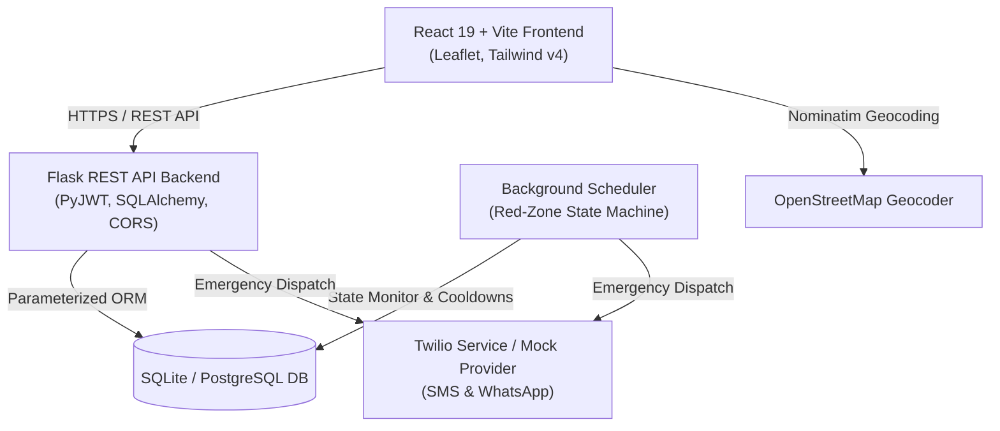

# 🛡️ CrimeSense — Real-Time Crime Analysis & Personal Safety Platform

**CrimeSense** is a comprehensive, production-grade personal safety and geospatial crime analysis platform. It combines real-time risk zone evaluation, automated stationary distress triggers, emergency contact dispatching (SMS / WhatsApp), privacy-centric temporary live-location sharing, and an administrative intelligence dashboard.

---

## 🌟 Key Features

### 👤 User Safety & Navigation
- **Mandatory Onboarding & SOS Contacts**: Requires 1 to 5 emergency contacts with E.164 phone validation and primary contact designation before accessing full app features.
- **Dynamic Zone Risk Engine**: Calculates live safety scores (**RED / High Risk**, **YELLOW / Moderate**, **GREEN / Safe**) using Haversine distance decay across localized incident databases.
- **Accidental-Proof SOS Distress Button**:
  - Requires a **2-second press-and-hold** trigger.
  - Features a **5-second cancel countdown** with sound and visual feedback.
  - Dispatches emergency notifications to contacts via Twilio SMS / WhatsApp with a direct Google Maps coordinates link.
  - Single-tap **"I'm Safe"** resolution sends all-clear updates to contacts and admins.
- **Automated Red-Zone Inactivity State Machine**:
  - Client streams lightweight 30-second heartbeats with user interaction & movement flags.
  - Server monitors stationary users in RED zones (`SAFE` → `IN_RED` → `WARNING` → `AUTO_ALERT_SENT`).
  - Triggers an interactive 60-second in-app safety check-in before automated distress dispatch.
  - Includes a 30-minute anti-spam cooldown per user.
- **Privacy-Preserving Location Sharing**:
  - One-click formatted WhatsApp sharing via `wa.me` links & Web Share API.
  - Unguessable, tokenized public links (`/s/:token`) with configurable expiry (**1h / 8h / 24h**), static/live options, and one-tap revocation.
- **Data Privacy & User Controls**:
  - Master Location Toggle to halt all tracking and background heartbeats.
  - Consent screen and setting to hide live coordinates from administrators.
  - One-click **"Delete Location History"** and complete **"Delete My Account"** self-service data purge.

---

### 🏛️ Admin Intelligence & Operations Portal (`/admin`)
- **Overview Dashboard**: High-level KPI summary cards, live safety telemetry, and crime category distribution charts.
- **Crime Incident Management (CRUD)**: Searchable, sortable, and filterable incident table with modal editor and bulk CSV export/import.
- **Historical Trends & Analytics**: Time-series analysis across years, months, and crime severities.
- **User Management**: Inspect user roles, contact counts, breadcrumb history, and toggle administrator privileges.
- **Live Dispatch Map**: Real-time map displaying users who have consented to live location sharing.
- **Active Alerts Feed**: Centralized queue of active SOS events with resolution tools.
- **Audit Logging**: Immutable audit trail recording administrative actions (`CRIME_CREATE`, `USER_ROLE_CHANGE`, `LOCATION_HISTORY_VIEW`, `SOS_RESOLVE`) with Admin ID, timestamps, and IP addresses.

---

## 🏗️ System Architecture



---

## 🔒 Security Hardening & Isolation

1. **Input Validation & Parameterized Queries**: All database queries utilize SQLAlchemy ORM with bound parameters, preventing SQL injection vulnerabilities.
2. **Strict User Data Isolation**: Every mutating and query endpoint enforces `user_id == current_user.id`. Cross-user inspection attempts return `404 Not Found` or `403 Forbidden`.
3. **Role-Based Access Control (RBAC)**: All administrative endpoints are guarded by the `@admin_required` decorator, returning `HTTP 403 Forbidden` for standard users.
4. **CORS & Security Headers**:
   - Restricts cross-origin access to origins listed in `CORS_ALLOWED_ORIGINS`.
   - Injects security headers on every response: `X-Content-Type-Options: nosniff`, `X-Frame-Options: SAMEORIGIN`, `X-XSS-Protection: 1; mode=block`, and `Strict-Transport-Security`.
5. **Secure Cookies & Tokens**: JWT tokens are signed with cryptographically secure keys, validated with expiration handling, and can be stored in HTTP-only, SameSite cookies.
6. **Data Retention**: Background worker purges expired share tokens and location breadcrumbs beyond the 30-day retention window.

---

## 🚀 Getting Started

### Prerequisites
- **Python**: 3.10+
- **Node.js**: 18+ and `npm`

---

### Backend Setup

1. **Navigate to backend directory**:
   ```bash
   cd backend
   ```

2. **Create and activate a virtual environment**:
   ```bash
   # Windows (PowerShell)
   python -m venv venv
   .\venv\Scripts\Activate.ps1

   # Linux / macOS
   python3 -m venv venv
   source venv/bin/activate
   ```

3. **Install dependencies**:
   ```bash
   pip install -r requirements.txt
   ```

4. **Configure Environment Variables**:
   Copy the example environment configuration:
   ```bash
   cp .env.example .env
   ```
   *Edit `.env` to configure your `JWT_SECRET_KEY`, `ADMIN_PASSWORD`, and notification credentials.*

5. **Run Database Migrations & Initial Seed**:
   ```bash
   python -c "from app import create_app; from extensions import db; app = create_app(); app.app_context().push(); db.create_all()"
   ```

6. **Start the Flask Development Server**:
   ```bash
   python run.py
   ```
   *Backend runs on `http://127.0.0.1:5000`.*

---

### Frontend Setup

1. **Navigate to frontend directory**:
   ```bash
   cd frontend
   ```

2. **Install dependencies**:
   ```bash
   npm install
   ```

3. **Start the Vite Development Server**:
   ```bash
   npm run dev
   ```
   *Frontend opens on `http://localhost:5173`.*

4. **Default Admin Login**:
   - **Email**: `admin@crimesense.org`
   - **Password**: `AdminSecurePass2026!`

---

## 🧪 Automated Testing

CrimeSense includes an automated test suite verifying all critical security and functional workflows:
- User signup, login, and JWT generation
- Cross-user data isolation (User A cannot access User B's contacts/saved locations)
- RBAC enforcement (`/api/admin/*` returns 403 for regular users)
- Zone risk calculation engine & distance decay
- SOS distress trigger and emergency event creation
- Share token generation, public viewing, and expiration verification
- Red-zone state machine stationary transitions

To execute the test suite:
```bash
cd backend
python -m unittest tests/test_crimesense_suite.py
```

---

## 📋 Manual QA Checklist

For full manual verification of end-to-end user journeys (first-time onboarding, GPS denied fallback, red-zone alarms, WhatsApp sharing, admin dashboard CRUD), refer to [`QA_CHECKLIST.md`](./QA_CHECKLIST.md).

---

## 🌐 Production Deployment & HTTPS Guidelines

When deploying CrimeSense to production environments:

### 1. Reverse Proxy (Nginx) & SSL/TLS
Always place the backend behind an Nginx reverse proxy with Let's Encrypt / Certbot SSL certificates:

```nginx
server {
    listen 80;
    server_name api.crimesense.org;
    return 301 https://$host$request_uri;
}

server {
    listen 443 ssl http2;
    server_name api.crimesense.org;

    ssl_certificate /etc/letsencrypt/live/api.crimesense.org/fullchain.pem;
    ssl_certificate_key /etc/letsencrypt/live/api.crimesense.org/privkey.pem;
    ssl_protocols TLSv1.2 TLSv1.3;
    ssl_ciphers HIGH:!aNULL:!MD5;

    # Security Headers
    add_header Strict-Transport-Security "max-age=31536000; includeSubDomains" always;
    add_header X-Frame-Options SAMEORIGIN always;
    add_header X-Content-Type-Options nosniff always;

    location / {
        proxy_pass http://127.0.0.1:5000;
        proxy_set_header Host $host;
        proxy_set_header X-Real-IP $remote_addr;
        proxy_set_header X-Forwarded-For $proxy_add_x_forwarded_for;
        proxy_set_header X-Forwarded-Proto https;
    }
}
```

### 2. WSGI Application Server (Gunicorn)
Run the Flask backend using Gunicorn with production worker processes:
```bash
gunicorn -w 4 -b 127.0.0.1:5000 "app:create_app()"
```

### 3. Frontend Static Build
Build the optimized React bundle and serve via Nginx or a CDN (Cloudflare / Vercel):
```bash
cd frontend
npm run build
```

---

## 📄 License
This project is licensed under the MIT License.
