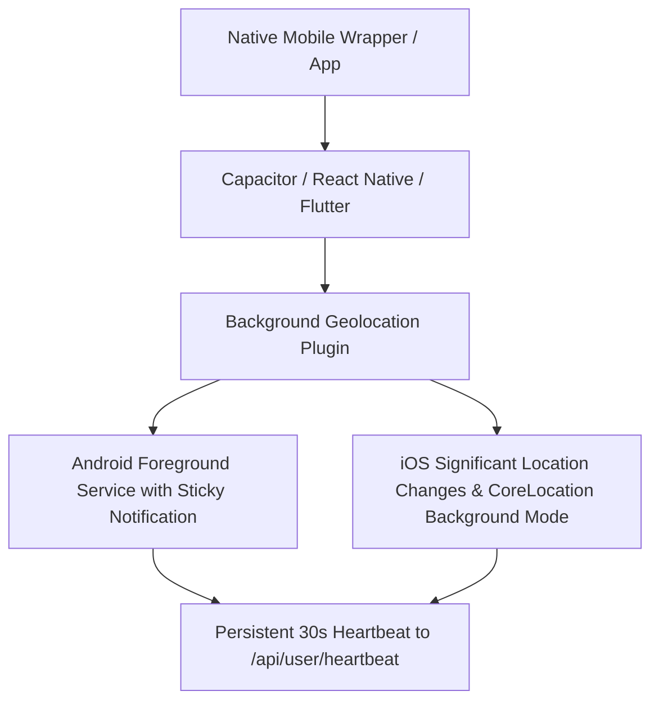

# CrimeSense Background Geolocation & Tracking Architecture

## 1. Web Browser Limitations with Background Tracking

Modern web browsers (Chrome, Safari, Firefox, Edge) enforce strict security and battery-preservation policies that intentionally restrict continuous GPS polling when web pages or PWAs are in the background or closed:

### Key Web Browser Constraints:
1. **Suspension of JavaScript Execution**: When a browser tab is minimized or the user locks the screen, timers (`setInterval`, `setTimeout`) and JavaScript execution are throttled or suspended within seconds.
2. **`navigator.geolocation.watchPosition` Throttling**: The W3C Geolocation API does not wake up or execute callbacks in background tabs without active user engagement.
3. **Service Worker Restrictions**: Service workers can receive push notifications via Web Push (VAPID), but they **cannot** periodically wake up to poll GPS coordinates autonomously without native OS hooks.
4. **iOS WebKit Policy**: On iOS Safari / PWA, background geolocation is strictly prohibited unless wrapped in a native container (`CLLocationManager` with `location` background mode capability).

---

## 2. Implemented Architecture in CrimeSense

CrimeSense implements a hybrid multi-layer safety framework to maximize reliability within browser capabilities:

### Layer 1: Foreground Heartbeat with Interaction & Movement Detection
- While the CrimeSense app is open, the client transmits a throttled heartbeat **every 30 seconds** containing:
  - Latitude, longitude, accuracy, and timestamp.
  - `has_interaction`: Tracks user touch, clicks, scrolls, keypresses, or physical GPS displacement exceeding **30 meters**.

### Layer 2: Server-Side State Machine & Background Scheduler
- Server-side state machine tracks each user across states:
  $$\text{SAFE} \longrightarrow \text{IN\_RED} \longrightarrow \text{WARNING} \longrightarrow \text{AUTO\_ALERT\_SENT}$$
- **Threshold Evaluation**: When a user's latest zone is `RED` and no movement (>30m) or interaction is recorded for $\ge \text{inactivity\_minutes}$ (default 10 minutes, configurable from 5–30 minutes), the server transitions to `WARNING`.
- **60-Second Safety Prompt**: A 60-second window is granted with an in-app and Web Push (VAPID) prompt: *"Are you safe?"*.
- **Auto SOS Trigger**: If no *"I'm Safe"* response is received before the 60s expires, the server creates an `auto_red_zone` SOS event and broadcasts emergency notifications to all configured contacts.
- **Stale Heartbeat Candidate**: If a user was in a `RED` zone and heartbeat stops for $> 15\text{ minutes}$, the server triggers an emergency alert citing *"Last known location"*.
- **Anti-Spam Cooldown**: A strict 30-minute cooldown prevents repetitive auto-alert triggering.

---

## 3. Requirements for True 24/7 Background Geolocation (Native App)

To achieve persistent, 24/7 background location tracking when the application is terminated or phone is in sleep mode, a native application container is required:

### Essential Native Components Needed:
1. **Android**:
   - `ACCESS_BACKGROUND_LOCATION` and `ACCESS_FINE_LOCATION` permissions.
   - Foreground Service with persistent status bar notification (`android.app.Service` + `NotificationCompat.Builder`).
   - Android Geofencing API (`Geofence.GEOFENCE_TRANSITION_ENTER` / `EXIT`).

2. **iOS**:
   - CoreLocation `UIBackgroundModes` containing `location` and `fetch`.
   - `CLLocationManager.allowsBackgroundLocationUpdates = true` and `pausesLocationUpdatesAutomatically = false`.
   - Significant-Change Location Service or Region Monitoring (`CLCircularRegion`).

3. **Recommended Plugins for Native Build**:
   - `@capacitor-community/background-geolocation`
   - `react-native-background-geolocation` (Transistor Software)
   - Native VAPID / Firebase Cloud Messaging (FCM) push handlers.

---

## 4. Testing the Flow with the Dev-Mode Simulator

To test the automated Red Zone inactivity and SOS trigger flow in seconds without waiting 10 minutes:
1. Open the CrimeSense User App (`/app`).
2. Click the **"Dev Red Zone Simulator"** pill on the top-left corner.
3. Click **"1. Enter RED Zone"** $\rightarrow$ User state switches to `IN_RED`.
4. Click **"2. Simulate Inactivity (1m)"** $\rightarrow$ Triggers the **"Are you safe?"** prompt.
5. Tap **"I'm Safe"** to test check-in reset, OR click **"4. Simulate Timeout"** to verify automatic SOS event creation and contact SMS dispatch.
