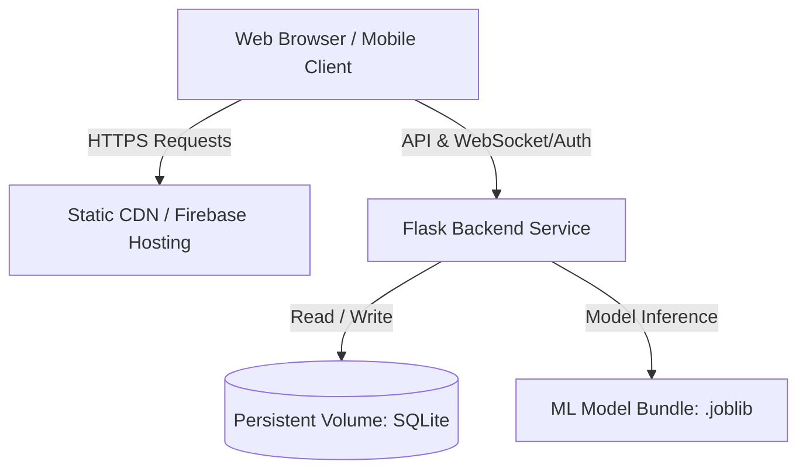

# CrimeSense — Deployment & Operational Readiness Guide

This guide details the procedures, architecture requirements, and operational considerations necessary to deploy the CrimeSense system into staging or production environments.

---

## 1. Architectural Architecture & Constraints



### 1.1 Critical Hosting Constraint: SQLite & Ephemeral Containers
The CrimeSense backend utilizes SQLite (`backend/instance/crimesense.db`) with SQLAlchemy.
- **Static Hosting (e.g., Firebase Hosting)**: Static hosting solutions only serve compiled frontend client files (`index.html`, JavaScript, CSS). They **cannot** execute the Python/Flask WSGI application or persist a local SQLite database.
- **Serverless / Ephemeral Containers**: Cloud functions or serverless container platforms that recreate containers on each request will reset SQLite data unless connected to a mounted persistent network volume.
- **Recommended Production Targets**:
  - Virtual Private Server (VPS) such as DigitalOcean, Hetzner, or AWS EC2.
  - Container platforms with persistent volume mounts (Render with Persistent Disk, Fly.io with Persistent Storage, or Railway with Persistent Volumes).

---

## 2. Environment Configuration

The backend reads configuration from environment variables or a local `.env` file.

| Variable Name | Required | Default (Dev) | Description |
| :--- | :--- | :--- | :--- |
| `FLASK_ENV` | Yes | `development` | Set to `production` in live environments. |
| `SECRET_KEY` | Yes | `default-insecure-dev-key` | Cryptographic secret for signing JWT tokens and session data. |
| `DATABASE_PATH` | No | `backend/instance/crimesense.db` | Absolute path to the SQLite database file. |
| `CORS_ORIGINS` | No | `*` | Comma-separated list of permitted frontend origins (e.g. `https://crime-sense.web.app`). |
| `PORT` | No | `5000` | Port for the WSGI server to bind to. |
| `VITE_API_URL` | Frontend | `http://localhost:5000` | URL endpoint that the React application uses to reach the Flask API. |
| `FRONTEND_URL` | No | `http://localhost:5173` | Base frontend URL used for constructing verification and password reset links. |
| `SMTP_HOST` | No* | *(Development log mode)* | SMTP server hostname (e.g., `smtp.gmail.com`, `smtp.sendgrid.net`). |
| `SMTP_PORT` | No | `587` | SMTP port (587 for STARTTLS, 465 for SSL). |
| `SMTP_USER` | No* | None | SMTP username / API key identity. |
| `SMTP_PASSWORD` | No* | None | SMTP account password or app-specific password / API token. |
| `SMTP_USE_TLS` | No | `true` | Whether to initiate STARTTLS encryption (`true`/`false`). |
| `SMTP_FROM_EMAIL`| No | `no-reply@crimesense.org` | Verified sender address shown in transactional emails. |
| `SMTP_FROM_NAME` | No | `CrimeSense Security` | Sender display name. |
| `REQUIRE_EMAIL_VERIFICATION` | No | `false` | When `true`, unverified accounts cannot log in until email is verified. |

*\*Note on Email Delivery: If SMTP credentials (`SMTP_HOST`, `SMTP_USER`, `SMTP_PASSWORD`) are omitted, CrimeSense runs in **Development Mode**: verification and reset tokens are cryptographically generated and logged to the backend console rather than dispatched via SMTP, preventing broken network calls.*

---

## 2.1 SMTP Email Provider Setup Instructions

To enable live email delivery for verification links and password resets:

### Option A: SendGrid / Resend / Mailgun (Recommended for Production)
1. Register for an account with an email delivery provider (e.g., SendGrid, Mailgun, or Resend).
2. Create an API Key with `Mail.Send` permissions.
3. Configure your verified sender identity (e.g., `security@yourdomain.com`).
4. Set the following environment variables in your backend environment:
   ```env
   SMTP_HOST=smtp.sendgrid.net
   SMTP_PORT=587
   SMTP_USER=apikey
   SMTP_PASSWORD=your_sendgrid_api_key_here
   SMTP_USE_TLS=true
   SMTP_FROM_EMAIL=security@yourdomain.com
   SMTP_FROM_NAME=CrimeSense Security
   FRONTEND_URL=https://your-crimesense-frontend.web.app
   REQUIRE_EMAIL_VERIFICATION=true
   ```

### Option B: Gmail SMTP (Development / Staging)
1. Enable 2-Step Verification on your Google Account.
2. Generate an **App Password** (under Google Account Security -> App Passwords).
3. Set the following environment variables:
   ```env
   SMTP_HOST=smtp.gmail.com
   SMTP_PORT=587
   SMTP_USER=your_gmail_address@gmail.com
   SMTP_PASSWORD=your_16_character_app_password
   SMTP_USE_TLS=true
   SMTP_FROM_EMAIL=your_gmail_address@gmail.com
   SMTP_FROM_NAME=CrimeSense Security
   ```

---

## 3. Local Startup Procedures

### 3.1 Backend Application Startup
Ensure the virtual environment is activated and dependencies are installed:
```powershell
# Set Python path and start the Flask server
$env:PYTHONPATH = "c:\Users\ADMIN\OneDrive\crime-analysis\backend;c:\Users\ADMIN\OneDrive\crime-analysis"
& "C:\Users\ADMIN\AppData\Local\Programs\Python\Python312\python.exe" backend/app.py
```
Alternatively, for a WSGI production worker run:
```powershell
gunicorn --bind 0.0.0.0:5000 --workers 2 "backend.app:create_app()"
```

### 3.2 Frontend Application Startup
```powershell
# Start Vite development server
npm --prefix frontend run dev
```
To build and preview the production bundle:
```powershell
# Create production build
npm --prefix frontend run build

# Preview production build locally
npm --prefix frontend run preview
```

---

## 4. Database Backup & Disaster Recovery Procedures

### 4.1 Creating a Timestamped Backup
Before executing schema migrations or significant updates, create a physical copy of the database:
```powershell
# Create timestamped backup
$Timestamp = Get-Date -Format "yyyyMMdd_HHmmss"
Copy-Item "backend/instance/crimesense.db" "backend/instance/crimesense_backup_$Timestamp.db"
```

### 4.2 Verifying Database Integrity
Run SQLite integrity check to ensure zero page corruption:
```powershell
& "C:\Users\ADMIN\AppData\Local\Programs\Python\Python312\python.exe" -c "import sqlite3; conn = sqlite3.connect('backend/instance/crimesense.db'); print(conn.cursor().execute('PRAGMA integrity_check;').fetchall()); conn.close()"
```

---

## 5. Post-Deployment Verification Checklist

Once deployed to a staging or production server:
1. **Health Check**:
   ```bash
   curl -I https://api.yourdomain.com/api/system/info
   ```
   Verify `HTTP 200 OK` and `status: "online"`.
2. **Database Verification**:
   Query `GET /api/crimes?per_page=1` and ensure total crime records match expectations (e.g. 685 records).
3. **Machine Learning Model Verification**:
   Query `GET /api/ml/model-info` to verify the pre-trained RandomForest model bundle is loaded.
4. **Authentication Flow**:
   Test `POST /api/auth/login` with an existing administrator account.
5. **Incident Reporting**:
   Submit a test report and confirm it appears in the administrator triage queue.
